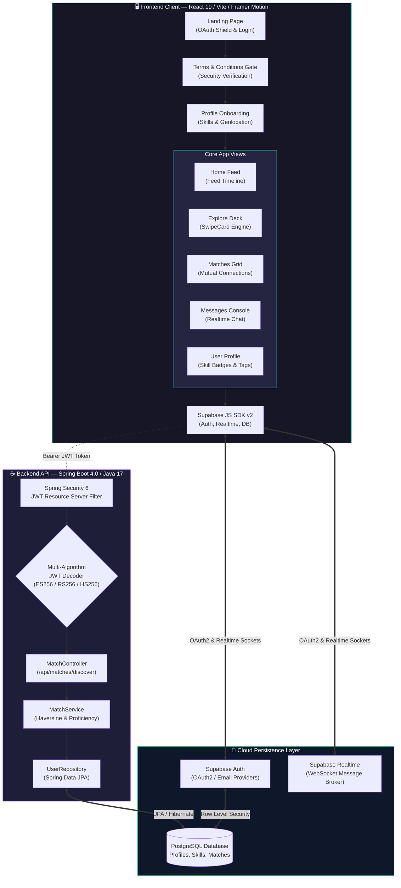
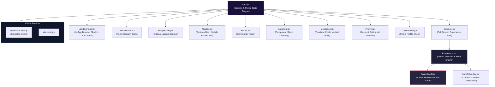
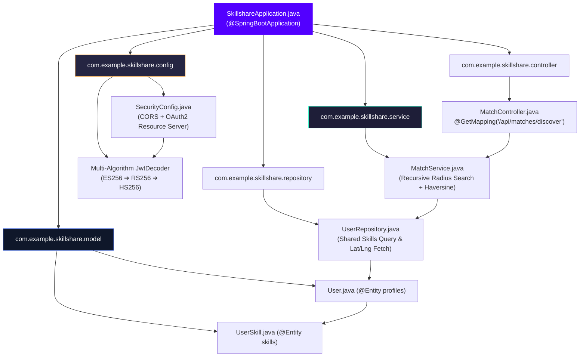
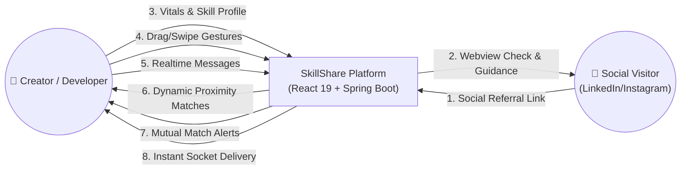
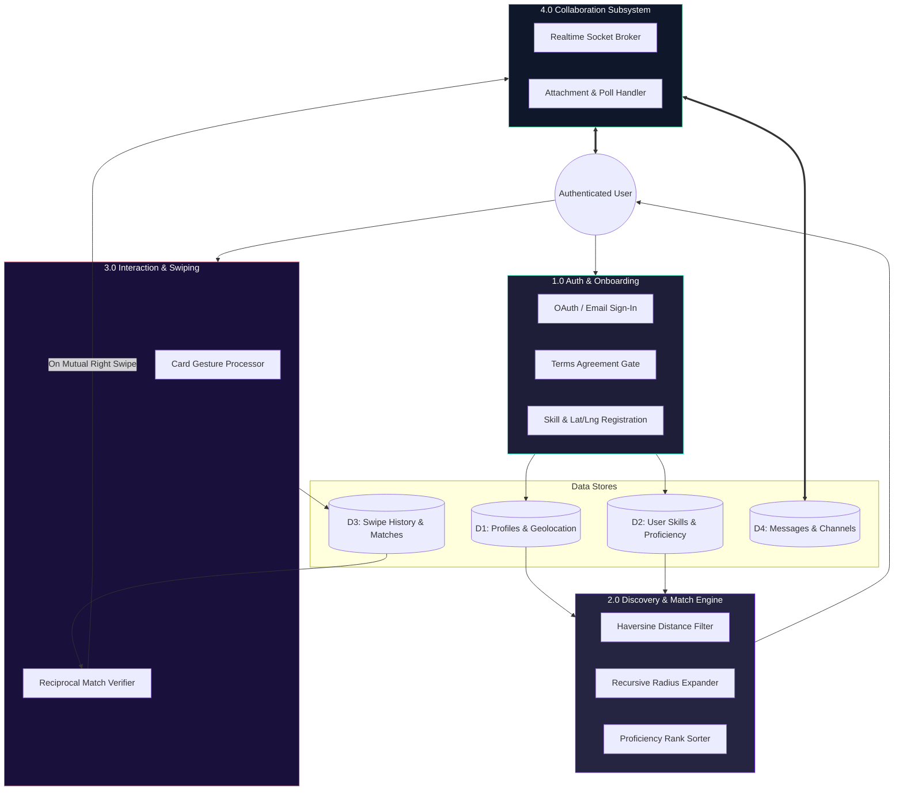
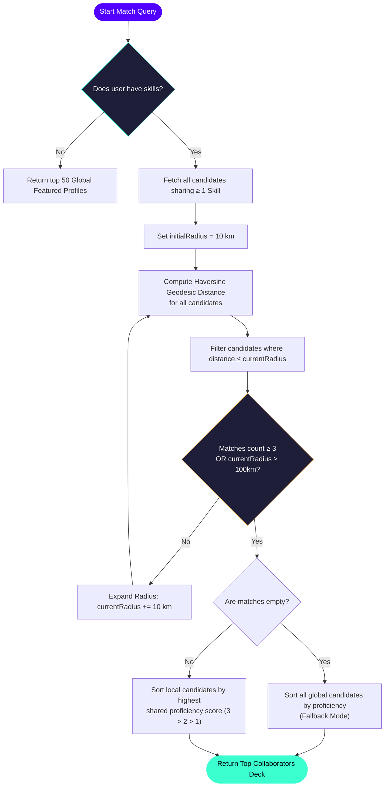
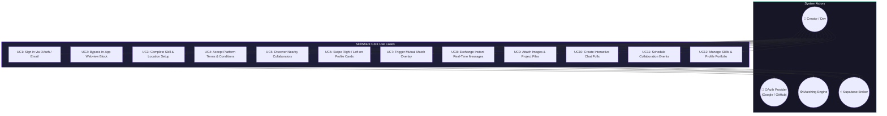
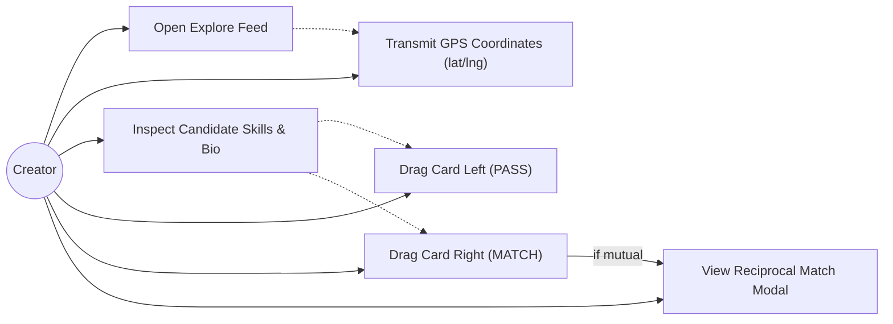
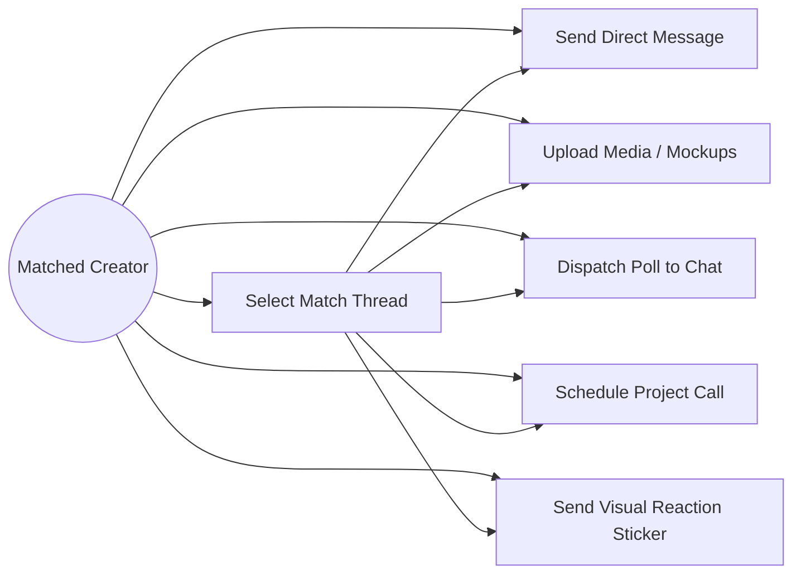
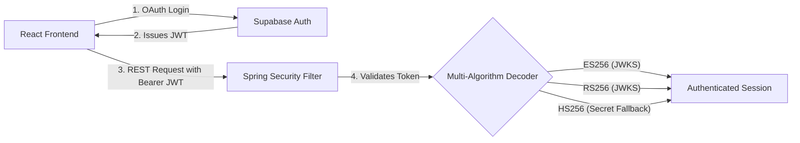

# 🚀 SkillShare — Swipe. Match. Collaborate.

<div align="center">

  

  # SkillShare

  ### Full-stack geolocation-aware skill matchmaking & collaboration platform for creators, designers, and developers

  [](https://skillshare-app-vercel-5s9b.vercel.app)
  [](https://github.com/PG300604/skillshare-app-vercel)
  [](https://openjdk.org/)
  [](https://react.dev/)
  [](https://supabase.com/)
  [](https://www.postgresql.org/)
  [](LICENSE)

</div>

---

## 📑 Table of Contents

- [Overview](#overview)
- [Key Features](#key-features)
- [System Architecture](#system-architecture)
  - [High-Level System Architecture](#high-level-system-architecture)
  - [Frontend Component Hierarchy](#frontend-component-hierarchy)
  - [Backend Package Architecture](#backend-package-architecture)
- [Data Flow Diagrams](#data-flow-diagrams)
  - [DFD Level 0 — Context Diagram](#dfd-level-0--context-diagram)
  - [DFD Level 1 — Major Subsystems](#dfd-level-1--major-subsystems)
  - [DFD Level 2 — Discovery & Swipe Pipeline](#dfd-level-2--discovery--swipe-pipeline)
  - [Dynamic Geolocation Expansion Pipeline](#dynamic-geolocation-expansion-pipeline)
- [Use Case Diagrams](#use-case-diagrams)
  - [Primary Use Case Diagram](#primary-use-case-diagram)
  - [Use Case: Creator Discovery & Swiping](#use-case-creator-discovery--swiping)
  - [Use Case: Real-Time Chat & Collaboration](#use-case-real-time-chat--collaboration)
- [Algorithmic Core — Haversine Match Engine](#algorithmic-core--haversine-match-engine)
- [Security & Authentication Pipeline](#security--authentication-pipeline)
- [In-App Browser OAuth Mitigation](#in-app-browser-oauth-mitigation)
- [Tech Stack](#tech-stack)
- [Project Structure](#project-structure)
- [Getting Started](#getting-started)
  - [Prerequisites](#prerequisites)
  - [Quick Start](#quick-start)
- [Environment Variables](#environment-variables)
- [Roadmap](#roadmap)
- [Author](#author)
- [License](#license)

---

## 📖 Overview

**SkillShare** is an interactive, full-stack, geolocation-aware networking and collaboration platform engineered specifically for creators, UI/UX designers, software engineers, and founders. Designed with the intuitive engagement mechanics of modern matchmaking apps, SkillShare transforms professional networking from cold, sterile messaging into dynamic, serendipitous collaborations.

Users swipe through rich profile cards highlighting complementary technical and creative skill sets. The underlying engine executes an intelligent **recursive Haversine radius search** paired with multi-level **proficiency ranking**, ensuring collaborators connect with the most qualified peers nearby before seamlessly falling back to global top talent.

### Core Capabilities at a Glance

- **Interactive Gesture Matching**: Smooth Tinder-style swiping powered by Framer Motion, spring physics, and multi-touch card dragging.
- **Dynamic Geolocation Routing**: Haversine distance calculations starting at a 10 km hyper-local radius and auto-expanding in 10 km increments up to 100 km.
- **Proficiency-Ranked Recommendation**: Sorts matches by verified skill depth (`Advanced` > `Intermediate` > `Beginner`) with automatic global fallback.
- **Instant WebSocket Messaging**: Sub-millisecond real-time chat with Supabase Realtime channels, rich media attachments, quick polls, event scheduling, and stickers.
- **OAuth In-App Browser Shield**: Proprietary user-agent sniffing and automated step-by-step fallback modal overcoming Google and GitHub OAuth blocks inside LinkedIn, Instagram, and Twitter webviews.
- **Enterprise Spring Security Resource Server**: Multi-algorithm JWT validation (`ES256`, `RS256`, `HS256`) against Supabase Auth with strict CORS enforcement.

---

## 🌟 Key Features

### 🤝 Swipe-Based Discovery Feed
| Capability | Details |
| :--- | :--- |
| **Physics-Based Cards** | Framer Motion & `@use-gesture/react` spring dragging with rotational tilt and swipe threshold triggers. |
| **Interactive Overlays** | Visual **LIKE** (Jelly Mint) and **PASS** (Hot Coral) dynamic stamp indicators reacting to drag coordinates. |
| **Reciprocal Match Popover** | Immediate mutual-match celebration modal when both creators swipe right, launching a direct chat channel. |
| **Card Deck Management** | Automatic client-side exclusion of previously swiped profiles to eliminate repeat evaluations. |

### 📍 Geolocation & Haversine Engine
| Capability | Details |
| :--- | :--- |
| **Haversine Geodesic Math** | Calculates true spherical surface distance (km) between GPS coordinates on Earth ($R = 6371\text{ km}$). |
| **Recursive Radius Expansion** | Initiates search at 10 km; if candidate count is below 3, automatically steps out (+10 km) up to a 100 km perimeter. |
| **Proficiency Matrix Sort** | Within matched distance brackets, profiles are weighted by maximum shared skill proficiency score (`Advanced=3`, `Intermediate=2`, `Beginner=1`). |
| **Global Talent Fallback** | If zero creators are within 100 km, seamlessly serves globally featured, proficiency-ranked profiles. |

### 🔒 In-App Browser OAuth Shield
| Capability | Details |
| :--- | :--- |
| **User-Agent Sniffing** | Detects restricted webview environments (`LinkedInApp`, `Instagram`, `FBAV`, `Twitter`, Android `wv`). |
| **Header Alert Banner** | Persistent ambient warning informing social visitors that third-party OAuth requires a standard browser. |
| **Step-by-Step Guidance Modal** | Prevents 403 `disallowed_useragent` errors by providing interactive instructions to open Safari or Chrome. |

### 💬 Real-Time Messaging & Collaboration
| Capability | Details |
| :--- | :--- |
| **Supabase Realtime Channels** | Postgres change-data-capture (CDC) subscriptions streaming instant peer messages without polling. |
| **Media Attachments** | Integrated file uploader supporting images, design mockups, and documents directly inside conversations. |
| **Interactive Tools** | In-chat voting polls, project event coordination calendars, and emoji sticker trays. |
| **Conversation Threads** | Dynamic sidebar tracking mutual matches, unread badges, and last active conversation states. |

### 📱 Responsive Mobile Architecture & Design
| Capability | Details |
| :--- | :--- |
| **Dual Navigation Paradigm** | Top desktop navigation bar smoothly morphs into an ergonomic mobile bottom navigation bar with iOS safe-area inset padding. |
| **High-Contrast Dark Canvas** | Precision-tuned dark aesthetic (`#12121e`) accented with neon cyan (`#3cffd0`) and hot coral highlight palettes. |
| **Social OpenGraph Metadata** | Dynamic Open Graph and Twitter Card tags configured with cache-busted production assets (`og-image.png?v=2`). |

---

## 🏛️ System Architecture

### High-Level System Architecture



---

### Frontend Component Hierarchy



---

### Backend Package Architecture



---

## 🔄 Data Flow Diagrams

### DFD Level 0 — Context Diagram



---

### DFD Level 1 — Major Subsystems



---

### DFD Level 2 — Discovery & Swipe Pipeline

```mermaid
sequenceDiagram
    autonumber
    actor Creator as 🎨 Creator (Frontend Client)
    participant Sec as Spring Security Filter
    participant Ctrl as MatchController
    participant Svc as MatchService
    participant Repo as UserRepository
    participant Supa as Supabase (Realtime / DB)

    Creator->>Sec: GET /api/matches/discover?lat=XX&lng=YY (Bearer JWT)
    Note over Sec: Validates Supabase JWT<br/>Decodes Subject (User UUID)
    Sec->>Ctrl: Authorized Request Dispatched
    Ctrl->>Svc: findCollaborators(currentUser, initialRadius = 10km)
    Svc->>Repo: findUsersWithSharedSkills(skillNames, currentUserId)
    Repo-->>Svc: Candidate List Sharing ≥ 1 Skill

    loop Recursive Haversine Radius Expansion
        Note over Svc: Filter candidates within radius R<br/>R starts at 10km; expands +10km up to 100km
    end

    Note over Svc: Sort matched pool by highest<br/>shared skill proficiency score
    Svc-->>Ctrl: Ranked List of Matching Collaborators
    Ctrl-->>Creator: 200 OK (Clean Deck of Candidates)

    Creator->>Creator: User Swipes Right on Match Candidate
    Creator->>Supa: INSERT into matches (user_id, target_id, direction='right')
    Creator->>Supa: SELECT reciprocal right-swipe
    alt Mutual Match Confirmed!
        Supa-->>Creator: Reciprocal match found
        Creator->>Creator: Trigger MatchOverlay celebration & open chat
    end
```

---

### Dynamic Geolocation Expansion Pipeline



---

## 🎯 Use Case Diagrams

### Primary Use Case Diagram



---

### Use Case: Creator Discovery & Swiping



---

### Use Case: Real-Time Chat & Collaboration



---

## 🧠 Algorithmic Core — Haversine Match Engine

The matchmaking core is implemented in Java inside [`MatchService.java`](src/main/java/com/example/skillshare/service/MatchService.java). It orchestrates a spatial-proficiency recommendation pipeline:

### 1. The Haversine Geodesic Formula
To accurately compute distance between two latitude and longitude points on the spherical Earth surface without spherical projection distortion:

$$\Delta\text{lat} = \text{lat}_2 - \text{lat}_1$$

$$\Delta\text{lon} = \text{lon}_2 - \text{lon}_1$$

$$a = \sin^2\left(\frac{\Delta\text{lat}}{2}\right) + \cos(\text{lat}_1) \cdot \cos(\text{lat}_2) \cdot \sin^2\left(\frac{\Delta\text{lon}}{2}\right)$$

$$c = 2 \cdot \text{atan2}\left(\sqrt{a}, \sqrt{1 - a}\right)$$

$$d = R \cdot c \quad (R = 6371\text{ km})$$

### 2. Recursive Radius Expansion
Instead of querying a fixed arbitrary distance, the engine implements progressive radius widening:
- **Phase 1**: Filters candidate matches within **$10\text{ km}$**.
- **Phase 2**: If the returned candidate count is $< 3$, the radius is expanded recursively by $+10\text{ km}$.
- **Phase 3**: The expansion ceiling caps at **$100\text{ km}$** to preserve local context.
- **Phase 4**: If no creators exist within $100\text{ km}$, the system falls back to top global profiles, ranking them purely by shared skill proficiency.

### 3. Proficiency Matrix Scoring
Within candidate groups, results are ranked by the maximum skill proficiency shared between the current user and the candidate:
- `Advanced` = **3 points**
- `Intermediate` = **2 points**
- `Beginner` = **1 point**

---

## 🔐 Security & Authentication Pipeline

SkillShare implements an enterprise-grade stateless security architecture linking the React frontend with the Spring Boot backend:



- **Multi-Algorithm Fallback**: Handles Supabase's migration between `ES256` and `RS256` asymmetric keys using Supabase's live `.well-known/jwks.json` endpoint, with an optional symmetric `HS256` secret fallback.
- **CORS Protection**: Explicit cross-origin allowance for Vercel production domains and local Vite dev hosts with credential forwarding.
- **Terms & Conditions Security Gate**: Newly authenticated users must acknowledge platform safety guidelines before accessing discovery routes.

---

## 🛡️ In-App Browser OAuth Mitigation

Major mobile social apps (LinkedIn, Instagram, Twitter/X) render shared links inside embedded WebViews that Google and GitHub actively block with `disallowed_useragent` errors. SkillShare implements proactive defense:

1. **Intelligent User-Agent Detection**:
   ```javascript
   const ua = navigator.userAgent || navigator.vendor || window.opera;
   const isInApp = /LinkedInApp|FBAV|FBAN|Instagram|Twitter|WebView|wv/i.test(ua);
   ```
2. **Context-Aware Alert Banner**: Displays an immediate warning at the top of the viewport when an in-app browser is detected.
3. **Modal Redirection Guidance**: Clicking social login triggers an illustrated 3-step guide explaining how to tap `•••` and select **"Open in Browser"** (Safari / Chrome).

---

## 🛠️ Tech Stack

| Layer | Technology | Version | Key Purpose |
| :--- | :--- | :--- | :--- |
| **Frontend Framework** | React | `19.2.5` | Next-generation declarative UI with concurrent rendering |
| **Build Tool** | Vite | `8.0.9` | Ultra-fast HMR and optimized production bundling |
| **Routing** | React Router | `7.14.2` | Declarative SPA client-side routing & navigation guards |
| **Animation** | Framer Motion | `12.38.0` | Production gesture animation, physics drags, and page transitions |
| **Gesture Engine** | @use-gesture/react | `10.3.1` | Multi-touch swipe coordination |
| **Icons** | Lucide React | `1.8.0` | Clean, modern feather icon set |
| **Backend Framework** | Spring Boot | `4.0.5` | Enterprise RESTful web services & dependency injection |
| **Language** | Java | `17 (LTS)` | High-performance compiled backend runtime |
| **Security** | Spring Security | `6.x` | Stateless OAuth2 JWT resource server validation & CORS |
| **Database** | PostgreSQL / H2 | `16` | Relational persistence for profiles, skills, and matches |
| **ORM / Data Access** | Spring Data JPA | `4.x` | Hibernate abstraction for relational database queries |
| **Auth & Sockets** | Supabase JS SDK | `2.104.0` | OAuth authentication & low-latency WebSocket messaging |
| **Containerization** | Docker | Multi-stage | Containerized backend packaging with Eclipse Temurin JRE |
| **Hosting** | Vercel & Docker | Production | Edge CDN frontend deployment and containerized backend |

---

## 📂 Project Structure

```
skillshare-app-vercel/
├── Dockerfile                             # Multi-stage Maven build & lightweight JRE runtime
├── mvnw / mvnw.cmd                        # Cross-platform Maven wrapper scripts
├── pom.xml                                # Maven POM dependencies (Spring Boot, Security, JPA)
├── setup-env.ps1                          # Environment configuration bootstrap script
│
├── src/main/java/com/example/skillshare/  # Spring Boot Backend Codebase
│   ├── SkillshareApplication.java         # Main Application Entrypoint
│   ├── config/
│   │   └── SecurityConfig.java            # JWT Decoder, CORS Policy & SecurityFilterChain
│   ├── controller/
│   │   └── MatchController.java           # GET /api/matches/discover Endpoint
│   ├── model/
│   │   ├── User.java                      # JPA Entity for Profiles table
│   │   └── UserSkill.java                 # JPA Entity for Skills & Proficiency
│   ├── repository/
│   │   └── UserRepository.java            # Spring Data JPA Repository with custom queries
│   └── service/
│       └── MatchService.java              # Haversine dynamic radius & proficiency sorting
│
├── src/main/resources/
│   ├── application.properties             # Spring configuration (PostgreSQL / H2 profiles)
│   └── schema.sql                         # Database schema definition
│
└── frontend/                              # React 19 Frontend SPA
    ├── index.html                         # HTML entrypoint with SEO & OG meta tags
    ├── package.json                       # NPM dependencies & scripts
    ├── vite.config.js                     # Vite build configuration
    ├── vercel.json                        # Single-Page-App routing rewrites for Vercel
    ├── public/
    │   ├── favicon.svg                    # SVG brand icon
    │   ├── icons.svg                      # System icon sprites
    │   └── og-image.png                   # High-res social preview card
    └── src/
        ├── App.jsx                        # Global routing, auth observer & terms gate
        ├── index.css                      # Design tokens, typography & CSS variables
        ├── supabaseClient.js              # Supabase client initialization
        ├── components/
        │   ├── Experience.jsx             # Card deck state manager & discovery loader
        │   ├── LandingPage.jsx            # Hero banner, email/OAuth form & webview modal
        │   ├── MatchOverlay.jsx           # Mutual match celebration popup
        │   ├── Navbar.jsx                 # Top bar + mobile sticky bottom tab navigation
        │   ├── SwipeCard.jsx              # Motion card with drag physics & gesture stamps
        │   └── TermsModal.jsx             # User agreement modal
        └── pages/
            ├── Explore.jsx                # Full-bleed swipe discovery view
            ├── Home.jsx                   # Community feed & featured creators
            ├── Matches.jsx                # Reciprocal matches gallery
            ├── Messages.jsx               # Real-time chat with media, polls & events
            ├── Profile.jsx                # User profile management & tag editor
            ├── SetupProfile.jsx           # Initial onboarding flow (skills + geolocation)
            └── UserProfile.jsx            # Dynamic creator profile viewer
```

---

## 🚀 Getting Started

### Prerequisites

- **Java 17+** & **Maven 3.9+** (or use included `./mvnw`)
- **Node.js 18+** & **npm**
- A **Supabase** account (Free Tier works great) for Auth, Realtime, and PostgreSQL

---

### Quick Start

#### 1. Clone the Repository
```bash
git clone https://github.com/PG300604/skillshare-app-vercel.git
cd skillshare-app-vercel
```

#### 2. Start the Backend API

By default, the backend can run in development mode with an in-memory **H2 database** seeded with sample creator profiles:

```bash
# On Linux / macOS:
./mvnw spring-boot:run

# On Windows PowerShell:
.\mvnw.cmd spring-boot:run
```

The Spring Boot backend will start at `http://localhost:8080`.

#### 3. Start the Frontend Application

```bash
cd frontend
npm install
npm run dev
```

The Vite dev server will launch at `http://localhost:5173`.

---

### 🐳 Docker Deployment

You can build and package the backend into an optimized Docker container:

```bash
# Build the Docker image
docker build -t skillshare-backend:latest .

# Run the container
docker run -p 8080:8080 \
  -e SPRING_SECURITY_OAUTH2_RESOURCESERVER_JWT_SECRET="your-jwt-secret" \
  skillshare-backend:latest
```

---

## ⚙️ Environment Variables

### Frontend (`frontend/.env.local`)

```env
# Supabase Configuration
VITE_SUPABASE_URL=https://your-project-ref.supabase.co
VITE_SUPABASE_ANON_KEY=eyJhbGciOi...your-anon-key

# Backend API Endpoint
VITE_API_URL=http://localhost:8080

# Design System Theme
VITE_THEME=warm-sunset
```

### Backend (`src/main/resources/application.properties` or OS Environment)

```properties
# Server Port
server.port=8080

# Supabase JWT Secret (Fallback for HS256)
spring.security.oauth2.resourceserver.jwt.secret=your-supabase-jwt-secret

# Production PostgreSQL Database (Optional for local dev, uses H2 if omitted)
spring.datasource.url=jdbc:postgresql://your-db-host:5432/postgres
spring.datasource.username=postgres
spring.datasource.password=your-password
spring.jpa.hibernate.ddl-auto=update
```

---

## 📈 Roadmap

- [ ] **AI Skill Complementarity Engine**: Vector embeddings comparing GitHub repositories to recommend non-obvious cross-discipline collaborators (e.g. AI Prompt Engineer + 3D Blender Artist).
- [ ] **Audio/Video Collab Rooms**: Integrated WebRTC peer-to-peer rooms for instant voice and video brainstorm sessions.
- [ ] **Dynamic WebSockets**: Server-sent notifications for incoming match alerts when the app is running in the background.
- [ ] **PostgreSQL Full-Text Search**: In-database trigram indexing for instant skill tag auto-complete and search.
- [ ] **Endorsements & Verified Portfolios**: Peer verification badges and GitHub repository showcase integrations.
- [ ] **React Native Mobile App**: Standalone iOS and Android native clients compiled from the React codebase.

---

## ✒️ Author

**Priyanshu Ghosh**
* Computer Science & Business Systems (CSBS) — Asansol Engineering College
* **LinkedIn**: [linkedin.com/in/priyanshughosh-](https://www.linkedin.com/in/priyanshughosh-)
* **GitHub**: [@PG300604](https://github.com/PG300604)

---

## 📄 License

This project is licensed under the **MIT License** — see the [LICENSE](LICENSE) file for full details.
